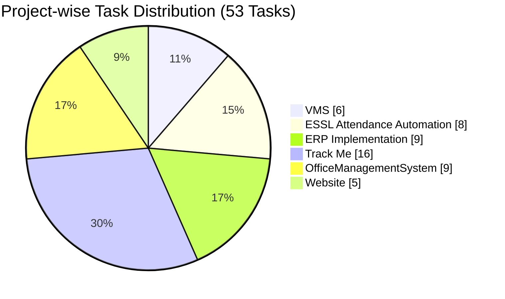
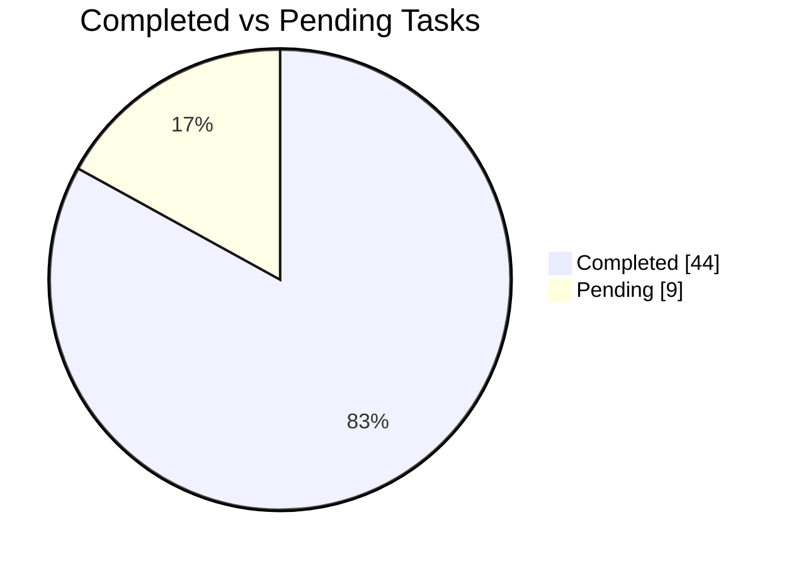
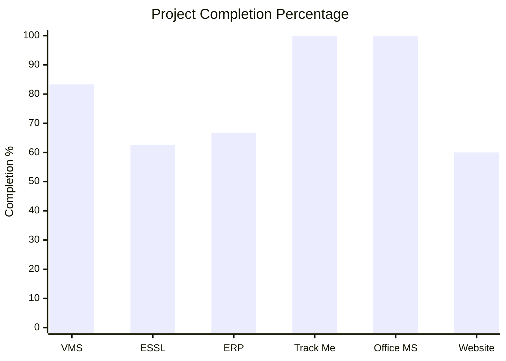

# 🌐 Global Task & Productivity Summary

> Aggregated analytics across all projects and development activities.

## 🏆 Executive Summary

- **Total Tasks Logged:** `53`
- **Total Completed:** `44` (✅)
- **Total Pending:** `9` (⏳)
- **Overall Completion:** `83.02%`
- **Client Review Completed:** `3`
- **Client Review Pending:** `0`

### Overall Project Status

| Metric | Count |
|---|---:|
| Total Tasks | 53 |
| Completed | 44 |
| Pending | 9 |
| Completion Rate | 83.02% |

---

## 🥧 Project-wise Task Distribution

## 🥧 Overall Task Completion Status

---

## 📊 Project-wise Progress

| Project | Total Tasks | Completed | Pending | Progress |
|---|---:|---:|---:|---:|
| VMS | 6 | 5 | 1 | 83.33% |
| ESSL Attendance Automation | 8 | 5 | 3 | 62.50% |
| ERP Implementation | 9 | 6 | 3 | 66.67% |
| Track Me | 16 | 16 | 0 | 100% |
| OfficeManagementSystem | 9 | 9 | 0 | 100% |
| Website | 5 | 3 | 2 | 60% |
| **Total** | **53** | **44** | **9** | **83.02%** |

## 📈 Project Completion Overview

---

## 📅 Daily Task Summary

| Date | Tasks Created | Completed | Pending | Progress |
|---|---:|---:|---:|---:|
| 20-11-2026 | 4 | 3 | 1 | 75% |
| 19-11-2026 | 2 | 2 | 0 | 100% |
| 18-11-2026 | 2 | 2 | 0 | 100% |
| 17-11-2026 | 1 | 1 | 0 | 100% |
| 16-11-2026 | 4 | 3 | 1 | 75% |
| 13-11-2026 | 8 | 5 | 3 | 62.50% |
| 12-11-2026 | 18 | 18 | 0 | 100% |
| 11-11-2026 | 8 | 5 | 3 | 62.50% |
| 07-11-2026 | 2 | 2 | 0 | 100% |
| 06-11-2026 | 4 | 3 | 1 | 75% |
| **Total** | **53** | **44** | **9** | **83.02%** |

## 📆 Weekly Task Summary

| Week | Total Tasks | Completed | Pending | Progress |
|---|---:|---:|---:|---:|
| 2026-W47 | 13 | 11 | 2 | 84.62% |
| 2026-W46 | 34 | 28 | 6 | 82.35% |
| 2026-W45 | 6 | 5 | 1 | 83.33% |
| **Total** | **53** | **44** | **9** | **83.02%** |

## 🗓️ Monthly Task Summary

| Month | Total Tasks | Completed | Pending | Progress |
|---|---:|---:|---:|---:|
| November 2026 | 53 | 44 | 9 | 83.02% |
| **Total** | **53** | **44** | **9** | **83.02%** |

---

**Last Updated:** 20 November 2026  
**Repository:** `My-Work-Diary`
