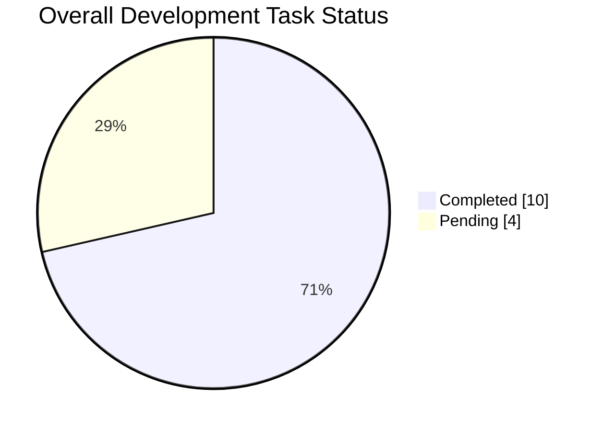
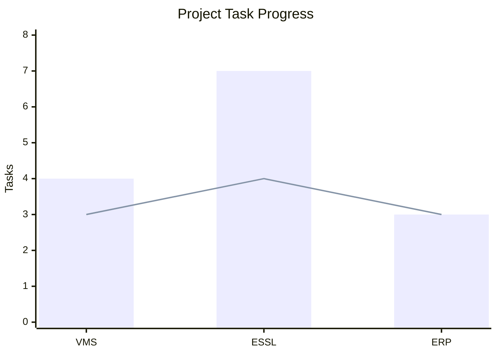

# 🌐 Global Task & Productivity Summary

> Aggregated analytics across all projects and development activities.

## 🏆 Executive Summary

- **Total Tasks Logged**: `14`
- **Total Completed**: `10` (✅)
- **Total Pending**: `4` (⏳)
- **Overall Completion Rate**: `71.43%`
- **Client-Side Review Pending**: `3`

## 🏢 Project-Wise Breakdown

| Project | Total Tasks | Completed | Pending | Completion Rate | Dashboard |
|---|---:|---:|---:|---:|---|
| **VMS** | 4 | 3 | 1 | 75% | [View Analytics](VMS/Analytics.md) |
| **ESSL Attendance** | 7 | 4 | 3 | 57.14% | [View Analytics](ESSL_Attendance/Analytics.md) |
| **ERP Implementation** | 3 | 3 | 0 | 100% | [View Analytics](ERP_Implementation/Analytics.md) |
| **Total** | **14** | **10** | **4** | **71.43%** | |

## 📊 Overall Task Distribution

## 📅 Multi-Period Performance

### 📆 Daily Aggregates

| Date | Created | Resolved | Pending | Day Completion |
|---|---:|---:|---:|---:|
| 06-11-2026 | 4 | 3 | 1 | 75% |
| 07-11-2026 | 2 | 2 | 0 | 100% |
| 11-11-2026 | 8 | 5 | 3 | 62.5% |
| **Total** | **14** | **10** | **4** | **71.43%** |

### 🗓️ Weekly Summary

| Week | Total Tasks | Resolved | Pending | Weekly Efficiency |
|---|---:|---:|---:|---:|
| 2026-W45 | 6 | 5 | 1 | 83.33% |
| 2026-W46 | 8 | 5 | 3 | 62.5% |

### 📊 Monthly Overview

| Month | Total Tasks | Resolved | Pending | Resolution Rate |
|---|---:|---:|---:|---:|
| November 2026 | 14 | 10 | 4 | 71.43% |

## 📈 Project Progress

*Bar: Total Tasks | Line: Completed Tasks*

## 📌 Current Project Status

| Project | Current Status |
|---|---|
| VMS | 🟡 1 development task pending |
| ESSL Attendance | 🟡 3 tasks pending |
| ERP Implementation | ✅ Development completed; client review pending |

## 🏢 Recent Implementation Updates

### 📅 07-11-2026 – ESSL Attendance Automation

**Institute:** Chikmagalur Medical Science College

- ✅ Database setup completed.
- ✅ Login credentials created.

### 📅 11-11-2026 – ESSL Attendance Automation

**Institute:** Chikmagalur Medical Science College

- ✅ Student data imported.
- ✅ Staff data imported.
- ⏳ Bug fixing pending.
- ⏳ Sorting verification pending.
- ⏳ Application flow testing pending.

### 📅 11-11-2026 – ERP Implementation

- ✅ Auto Block Allotment – Block and Subject Selection.
- ✅ Examination Hall Seating Allocation.
- ✅ Attendance Report and Exam Timetable Report.
- ⏳ Client-side review and confirmation pending.

## 📊 Client Review Tracking

| Project | Development | Client Review |
|---|---|---|
| ERP Implementation | ✅ Completed | ⏳ Pending (3 tasks) |

> Client-side review is tracked separately and is not included in development pending task counts.

## 📝 Notes

- Previous work records should be retained.
- Add new tasks to the relevant project's `WorkLog.md`.
- Update the corresponding `Analytics.md` when task statuses change.
- Update this global summary whenever a new project or task is added.
- Avoid counting an existing pending task again as a newly created task when it is completed later.
- Track client-side review separately from development completion.
- Maintain accurate project-wise and date-wise analytics.

---

*Last Updated: 11 November 2026*  
*Repository: My-Work-Diary*
