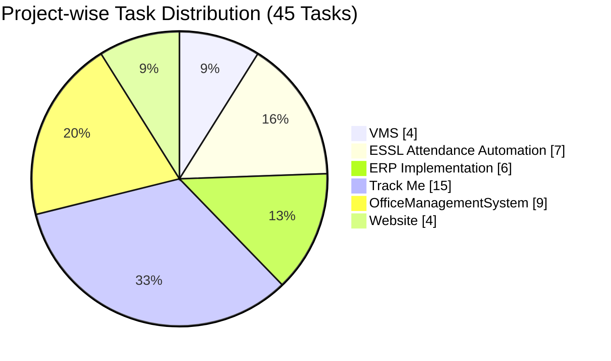
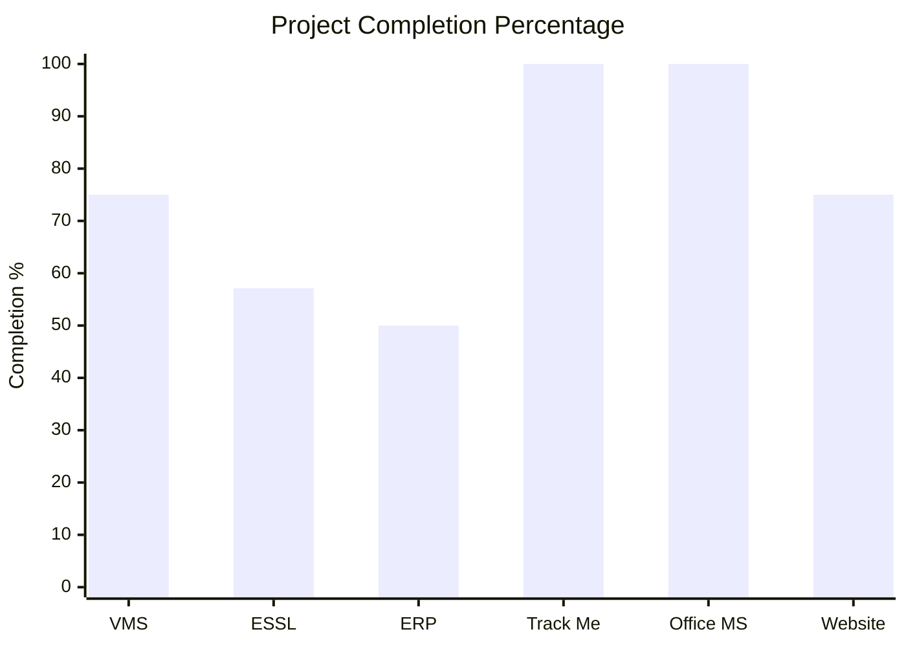

# 🌐 Global Task & Productivity Summary

> Aggregated analytics across all projects and development activities.

## 🏆 Executive Summary

- **Total Tasks Logged:** `45`
- **Total Completed:** `37` (✅)
- **Total Pending:** `8` (⏳)
- **Overall Completion:** `82.22%`
- **Client Review Completed:** `3`
- **Client Review Pending:** `0`

### Overall Project Status

| Metric | Count |
|---|---:|
| Total Tasks | 45 |
| Completed | 37 |
| Pending | 8 |
| Completion Rate | 82.22% |

---

## 🥧 Project-wise Task Distribution

## 🥧 Overall Task Completion Status

---

## 📊 Project-wise Progress

| Project | Total Tasks | Completed | Pending | Progress |
|---|---:|---:|---:|---:|
| VMS | 4 | 3 | 1 | 75% |
| ESSL Attendance Automation | 7 | 4 | 3 | 57.14% |
| ERP Implementation | 6 | 3 | 3 | 50% |
| Track Me | 15 | 15 | 0 | 100% |
| OfficeManagementSystem | 9 | 9 | 0 | 100% |
| Website | 4 | 3 | 1 | 75% |
| **Total** | **45** | **37** | **8** | **82.22%** |

## 📈 Project Completion Overview

---

## 📅 Daily Task Summary

| Date | Tasks Created | Completed | Pending | Progress |
|---|---:|---:|---:|---:|
| 17-11-2026 | 1 | 1 | 0 | 100% |
| 16-11-2026 | 4 | 3 | 1 | 75% |
| 13-11-2026 | 8 | 5 | 3 | 62.50% |
| 12-11-2026 | 18 | 18 | 0 | 100% |
| 11-11-2026 | 8 | 5 | 3 | 62.50% |
| 07-11-2026 | 2 | 2 | 0 | 100% |
| 06-11-2026 | 4 | 3 | 1 | 75% |
| **Total** | **45** | **37** | **8** | **82.22%** |

## 📆 Weekly Task Summary

| Week | Total Tasks | Completed | Pending | Progress |
|---|---:|---:|---:|---:|
| 2026-W45 | 6 | 5 | 1 | 83.33% |
| 2026-W46 | 34 | 28 | 6 | 82.35% |
| 2026-W47 | 5 | 4 | 1 | 80% |
| **Total** | **45** | **37** | **8** | **82.22%** |

## 🗓️ Monthly Task Summary

| Month | Total Tasks | Completed | Pending | Progress |
|---|---:|---:|---:|---:|
| November 2026 | 45 | 37 | 8 | 82.22% |
| **Total** | **45** | **37** | **8** | **82.22%** |

---

**Last Updated:** 17 November 2026  
**Repository:** `My-Work-Diary`
