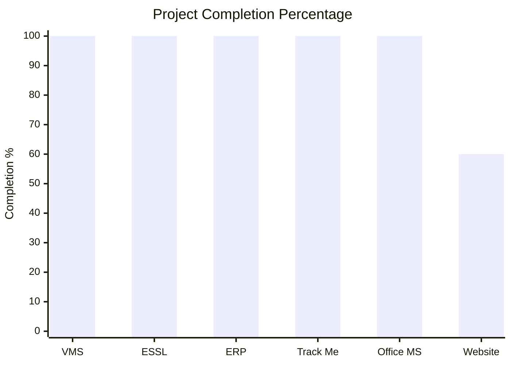

# 🌐 Global Task & Productivity Summary

> Aggregated analytics across all projects and development activities.

## 🏆 Executive Summary

- **Total Tasks Logged:** `53`
- **Total Completed:** `51` (✅)
- **Total Pending:** `2` (⏳)
- **Overall Completion:** `96.23%`
- **Client Review Completed:** `3`
- **Client Review Pending:** `0`

### Overall Project Status

| Metric | Count |
|---|---:|
| Total Tasks | 53 |
| Completed | 51 |
| Pending | 2 |
| Completion Rate | 96.23% |

---

## 🥧 Project-wise Task Distribution

```java
pie showData
    title Project-wise Task Distribution (53 Tasks)
    "VMS" : 6
    "ESSL Attendance Automation" : 8
    "ERP Implementation" : 9
    "Track Me" : 16
    "OfficeManagementSystem" : 9
    "Website" : 5
```

## 🥧 Overall Task Completion Status

```arduino
pie showData
    title Completed vs Pending Tasks
    "Completed" : 51
    "Pending" : 2
```

---

## 📊 Project-wise Progress

| Project | Total Tasks | Completed | Pending | Progress |
|---|---:|---:|---:|---:|
| VMS | 6 | 6 | 0 | 100% |
| ESSL Attendance Automation | 8 | 8 | 0 | 100% |
| ERP Implementation | 9 | 9 | 0 | 100% |
| Track Me | 16 | 16 | 0 | 100% |
| OfficeManagementSystem | 9 | 9 | 0 | 100% |
| Website | 5 | 3 | 2 | 60% |
| **Total** | **53** | **51** | **2** | **96.23%** |

## 📈 Project Completion Overview



---

## 📅 Daily Task Summary

| Date | Tasks Created |
|---|---:|
| 20-11-2026 | 4 |
| 19-11-2026 | 2 |
| 18-11-2026 | 2 |
| 17-11-2026 | 1 |
| 16-11-2026 | 4 |
| 13-11-2026 | 8 |
| 12-11-2026 | 18 |
| 11-11-2026 | 8 |
| 07-11-2026 | 2 |
| 06-11-2026 | 4 |
| **Total** | **53** |

## 📆 Weekly Task Summary

| Week | Total Tasks |
|---|---:|
| 2026-W47 | 13 |
| 2026-W46 | 34 |
| 2026-W45 | 6 |
| **Total** | **53** |

## 🗓️ Monthly Task Summary

| Month | Total Tasks |
|---|---:|
| November 2026 | 53 |
| **Total** | **53** |

---

## 🎯 Final Project Status

- ✅ VMS – 100% Completed
- ✅ ESSL Attendance Automation – 100% Completed
- ✅ ERP Implementation – 100% Completed
- ✅ Track Me – 100% Completed
- ✅ OfficeManagementSystem – 100% Completed
- ⏳ Website – 60% Completed (2 Tasks Pending)

**Overall Achievement: 96.23%**

**Last Updated:** 20 November 2026

**Repository:** `My-Work-Diary`
