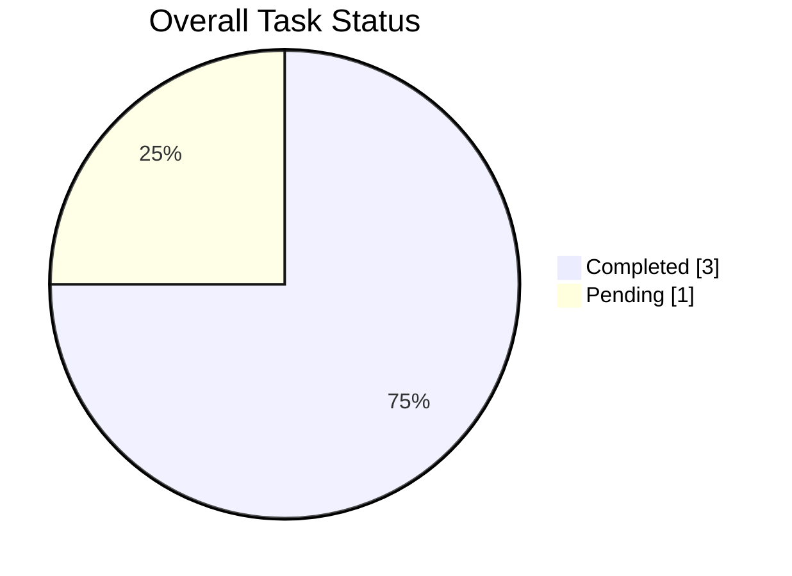
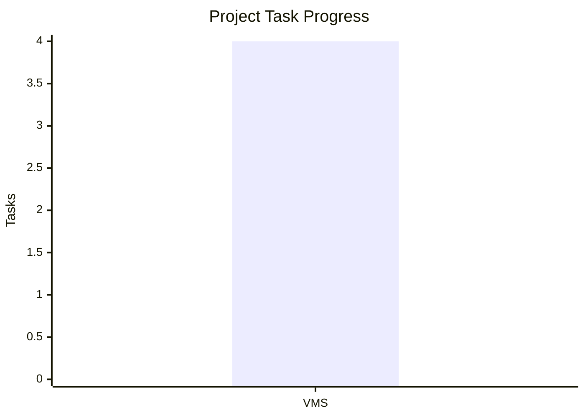

# 🌐 Global Task & Productivity Summary

> Aggregated analytics across all projects and development activities.

## 🏆 Executive Summary

- **Total Tasks Logged**: `4`
- **Total Completed**: `3` (✅)
- **Total Pending**: `1` (⏳)
- **Overall Completion Rate**: `75%`

## 🏢 Project-Wise Breakdown

| Project | Total Tasks | Completed | Pending | Completion Rate | Dashboard |
|---|---:|---:|---:|---:|---|
| **VMS** | 4 | 3 | 1 | 75% | [View Analytics](VMS/Analytics.md) |

## 📊 Overall Task Distribution

## 📅 Multi-Period Performance

### 📆 Daily Aggregates

| Date | Created | Resolved | Pending | Day Completion |
|---|---:|---:|---:|---:|
| 06-11-2026 | 4 | 3 | 1 | 75% |

### 🗓️ Weekly Summary

| Week | Total Tasks | Resolved | Pending | Weekly Efficiency |
|---|---:|---:|---:|---:|
| 2026-W45 | 4 | 3 | 1 | 75% |

### 📊 Monthly Overview

| Month | Total Tasks | Resolved | Pending | Resolution Rate |
|---|---:|---:|---:|---:|
| November 2026 | 4 | 3 | 1 | 75% |

## 📈 Project Progress

*Bar: Total Tasks | Line: Completed Tasks*

## 📌 Current Project Status

| Project | Current Status |
|---|---|
| VMS | 🟡 1 task pending |

## 📝 Notes

- Previous work records should be retained.
- Add new tasks to the relevant project's `WorkLog.md`.
- Update the corresponding `Analytics.md` when task statuses change.
- Update this global summary whenever a new project or task is added.
- Avoid counting an existing pending task again as a newly created task when it is completed later.

---

*Last Updated: 06 November 2026*
*Repository: MyWorkDiary*
