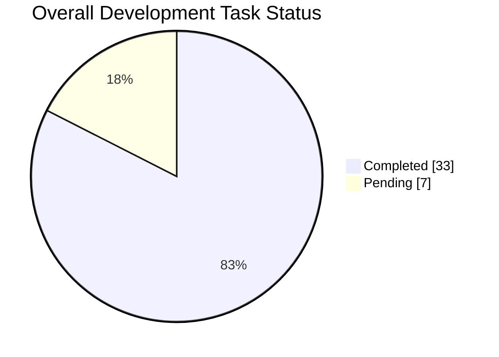
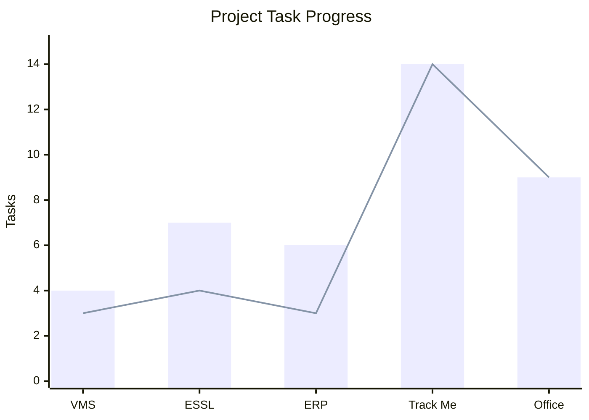

# 🌐 Global Task & Productivity Summary

> Aggregated analytics across all projects and development activities.

## 🏆 Executive Summary

- **Total Tasks Logged**: `40`
- **Total Completed**: `33` (✅)
- **Total Pending**: `7` (⏳)
- **Overall Completion Rate**: `82.50%`
- **Client-Side Review Completed**: `3`
- **Client-Side Review Pending**: `0`

## 🏢 Project-Wise Breakdown

| Project | Total Tasks | Completed | Pending | Completion Rate | Dashboard |
|---|---:|---:|---:|---:|---|
| **VMS** | 4 | 3 | 1 | 75% | [View Analytics](VMS/Analytics.md) |
| **ESSL Attendance** | 7 | 4 | 3 | 57.14% | [View Analytics](ESSL_Attendance/Analytics.md) |
| **ERP Implementation** | 6 | 3 | 3 | 50% | [View Analytics](ERP_Implementation/Analytics.md) |
| **Track Me** | 14 | 14 | 0 | 100% | [View Analytics](Track_Me/Analytics.md) |
| **OfficeManagementSystem** | 9 | 9 | 0 | 100% | [View Analytics](OfficeManagementSystem/Analytics.md) |
| **Total** | **40** | **33** | **7** | **82.50%** | |

## 📊 Overall Task Distribution

## 📅 Multi-Period Performance

### 📆 Daily Aggregates

| Date | Created | Resolved | Pending | Day Completion |
|---|---:|---:|---:|---:|
| 13-11-2026 | 8 | 5 | 3 | 62.50% |
| 12-11-2026 | 9 | 9 | 0 | 100% |
| 11-11-2026 | 8 | 5 | 3 | 62.50% |
| 07-11-2026 | 2 | 2 | 0 | 100% |
| 06-11-2026 | 4 | 3 | 1 | 75% |
| 12-06-2026 | 9 | 9 | 0 | 100% |
| **Total** | **40** | **33** | **7** | **82.50%** |

### 🗓️ Weekly Summary

| Week | Total Tasks | Resolved | Pending | Weekly Efficiency |
|---|---:|---:|---:|---:|
| 2026-W24 | 9 | 9 | 0 | 100% |
| 2026-W45 | 6 | 5 | 1 | 83.33% |
| 2026-W46 | 25 | 19 | 6 | 76% |
| **Total** | **40** | **33** | **7** | **82.50%** |

### 📊 Monthly Overview

| Month | Total Tasks | Resolved | Pending | Resolution Rate |
|---|---:|---:|---:|---:|
| June 2026 | 9 | 9 | 0 | 100% |
| November 2026 | 31 | 24 | 7 | 77.42% |
| **Total** | **40** | **33** | **7** | **82.50%** |

## 📈 Project Progress

*Bar: Total Tasks | Line: Completed Tasks*

## 📌 Current Project Status

| Project | Current Status |
|---|---|
| VMS | 🟡 1 development task pending |
| ESSL Attendance | 🟡 3 tasks pending |
| ERP Implementation | 🟡 3 new development tasks pending; previous 3 tasks reviewed by client |
| Track Me | ✅ All 14 logged tasks completed |
| OfficeManagementSystem | ✅ All 9 logged tasks completed |

---

## 🏢 Recent Implementation Updates

### 📅 13-11-2026 – ERP Implementation

**Module:** Examination Management & Examination Reports

**Client Review – Previous Requirements**
- ✅ Auto Block Allotment – Block & Subject Selection reviewed.
- ✅ Examination Hall Seating Allocation reviewed.
- ✅ Attendance Report & Exam Timetable Report reviewed.

**New Requirements & Changes Received**

1. **Auto Block Allotment – Remaining Block & Subject Management**
   - ⏳ Display remaining unallotted Blocks.
   - ⏳ Display only the Subjects that are yet to be allotted.
   - ⏳ Display pending student count against each remaining Subject.
   - ⏳ Exclude already allotted Subjects from the next allotment.

2. **Attendance List Report – Roll Number Display**
   - ⏳ Arrange students in ascending order by Roll Number.
   - ⏳ Display only Roll Number instead of Student ID.
   - ⏳ Remove unnecessary student identification details.
   - ⏳ Apply the same changes to relevant attendance reports, including Ganesh Abs.

3. **Attendance List Report – Layout Modifications**
   - ⏳ Display Institute Name: Lingaraj College (Autonomous), Belagavi.
   - ⏳ Display Block Number as Hall No.
   - ⏳ Remove Room Number.
   - ⏳ Display Absent, Present, Not Eligible (NE), and Total on the left side.
   - ⏳ Provide Signature of Invigilator and Date on the right side.

**Status:** 3 new requirements received and pending development.

### 📅 13-11-2026 – Track Me Project

**Staff App**
- ✅ Attendance Report page updated with mobile-responsive design.
- ✅ New Alerts page implemented.
- ✅ Alerts page designed with mobile-responsive layout.
- ✅ Staff App bugs fixed.
- ✅ UI and mobile responsiveness improved.

**Student App**
- ✅ New Alerts page implemented.
- ✅ Alerts page designed with a mobile app-style interface.
- ✅ Mobile-responsive layout implemented.
- ✅ Existing Student App bugs fixed.
- ✅ UI and user experience improved.

**Testing & Improvements**
- ✅ Bug fixing completed across Staff and Student Apps.
- ✅ Updated Attendance Report and Alerts pages tested.
- ✅ Mobile UI and responsiveness improvements completed.

**Status:** All listed tasks completed.

### 📅 12-11-2026 – OfficeManagementSystem

- ✅ Connected to the existing project environment.
- ✅ Identified and resolved existing project errors.
- ✅ Investigated project execution issues.
- ✅ Identified missing project files.
- ✅ Updated required missing files.
- ✅ Fixed errors and successfully executed the project.
- ✅ Verified project structure and execution.
- ✅ Guided Shraddha through project setup and execution.
- ✅ Provided technical guidance for the next development activities.

**Status:** All listed tasks completed.

### 📅 12-06-2026 – Track Me Project

- ✅ Student App Login functionality updated and verified.
- ✅ Parent App Login functionality updated and verified.
- ✅ Staff App Login functionality updated and verified.
- ✅ `BL_Login` module updated.
- ✅ `BL_Cookie` module updated.
- ✅ All three applications' Login and Logout pages updated.
- ✅ Major issues in Student and Parent Apps resolved.
- ✅ Login, logout, authentication, and cookie management tested.
- ✅ All identified bugs fixed.

**Status:** All 9 previously logged tasks completed.

### 📅 11-11-2026 – ERP Implementation

- ✅ Auto Block Allotment – Block and Subject Selection.
- ✅ Examination Hall Seating Allocation.
- ✅ Attendance Report and Exam Timetable Report.
- ⏳ Client-side review pending at the time of development completion.

**Status:** All 3 development tasks completed.

### 📅 11-11-2026 – ESSL Attendance Automation

**Institute:** Chikmagalur Medical Science College

- ✅ Student data imported.
- ✅ Staff data imported.
- ⏳ Bug fixing pending.
- ⏳ Sorting verification pending.
- ⏳ Application flow testing pending.

### 📅 07-11-2026 – ESSL Attendance Automation

**Institute:** Chikmagalur Medical Science College

- ✅ Database setup completed.
- ✅ Login credentials created.

---

## 📊 Client Review Tracking

| Project | Development Status | Client Review Status |
|---|---|---|
| ERP Implementation – Previous 3 Tasks | ✅ Completed | ✅ Reviewed on 13-11-2026 |
| ERP Implementation – New 3 Requirements | ⏳ Pending Development | Not Yet Applicable |

**Client Review Summary:**
- Previous completed requirements: 3 reviewed.
- Client review pending for previous requirements: 0.
- New requirements: 3 pending development.

> Client-side review is tracked separately and is not included in development pending task counts.

## 📝 Notes

- Previous work records should be retained.
- Add new tasks to the relevant project's `WorkLog.md`.
- Update the corresponding `Analytics.md` when task statuses change.
- Update this global summary whenever a new project or task is added.
- Arrange recent implementation updates in descending date order.
- Avoid counting an existing pending task again as a newly created task when it is completed later.
- Track client-side review separately from development completion.
- Maintain accurate project-wise and date-wise analytics.
- Keep development completion and client review status separate.
- Maintain separate analytics for OfficeManagementSystem.
- Update daily, weekly, and monthly aggregates whenever new tasks are recorded.
- Maintain consistent task counts across project analytics and the global summary.

---

*Last Updated: 13 November 2026*  
*Repository: My-Work-Diary*
