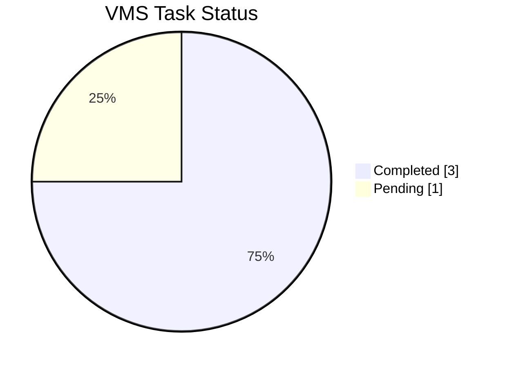
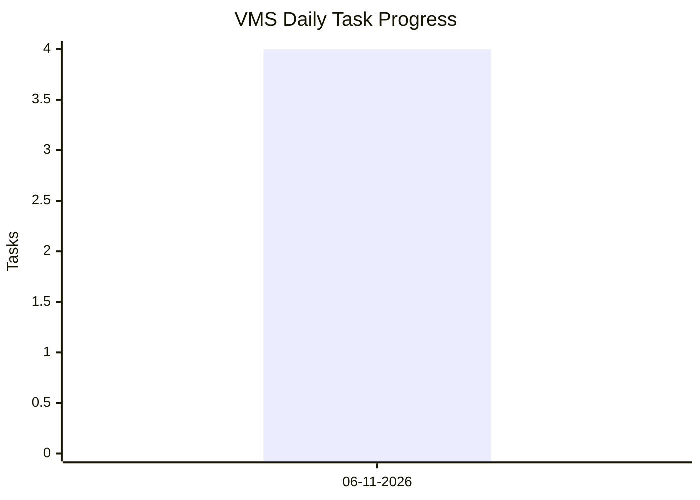

# 📊 Task & Progress Analytics: VMS

> Project analytics tracking development requirements, completed tasks, pending tasks, and daily progress.

## 📈 Overall Metrics

- **Total Tasks**: `4`
- **Completed**: `3` (✅)
- **Pending**: `1` (⏳)
- **Resolution Rate**: `75%`

## 📊 Overall Task Distribution

## 📅 Daily Throughput

| **Date** | **Completed** | **Pending** | **Total** | **Status** |
|---|---:|---:|---:|---|
| 06-11-2026 | 3 | 1 | 4 | ⏳ 1 Pending |

## 📉 Daily Development Progress

*Bar: Total Created | Line: Completed*

## 📋 Task Details

| Task Description | Status |
|---|---|
| Vehicle Due List – From Date & To Date | ✅ Completed |
| Remove Scrapped Vehicles from Driver Mapping | ✅ Completed |
| Create Additional Admin ID for Assistant In-charge | ✅ Completed |
| Display Mapped Vehicle Registration Number in Driver List | ⏳ Pending |

## 📌 Project Progress

- **Total Requirements:** 4
- **Completed Requirements:** 3
- **Remaining Requirements:** 1
- **Overall Progress:** 75%

---

*Last Updated: 06 November 2026*  
*Project: Vehicle Management System (VMS)*
