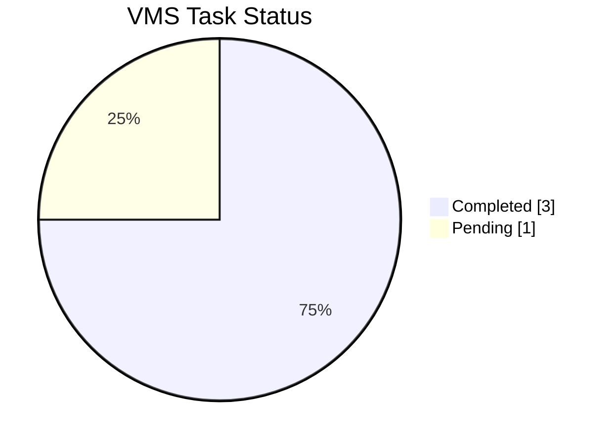
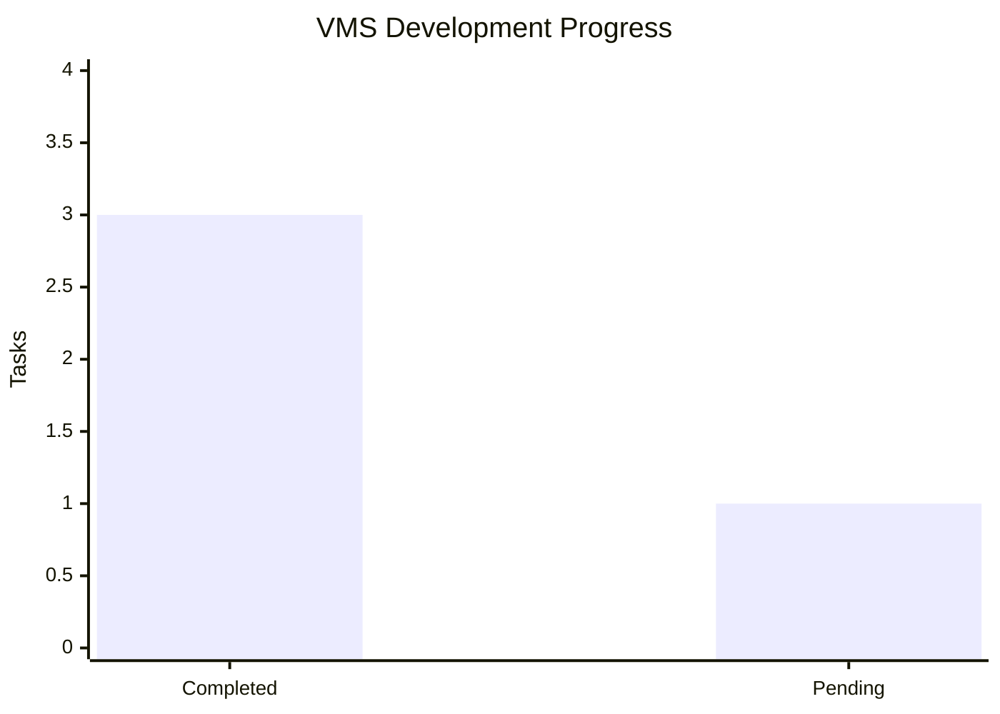

# 📊 VMS – Task Analytics

## Task Summary

| Metric | Count |
|---|---:|
| Total Tasks | 4 |
| Completed | 3 |
| In Progress | 0 |
| Pending | 1 |
| Completion Rate | 75% |

## Task Status Distribution

## Task Details

| Task | Status |
|---|---|
| Vehicle Due List Date Filters | Completed |
| Remove Scrapped Vehicles | Completed |
| Additional Admin ID | Completed |
| Mapped Vehicle Registration in Driver List | Pending |

## Overall Progress

**Last Updated:** 06 November 2026
