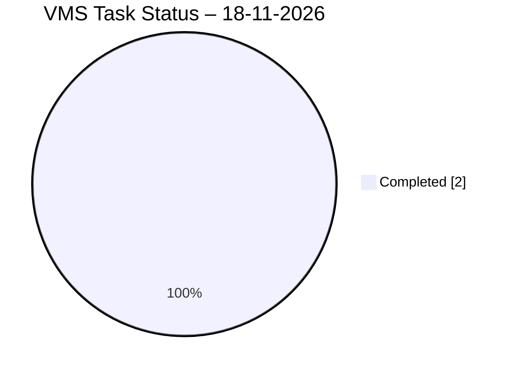
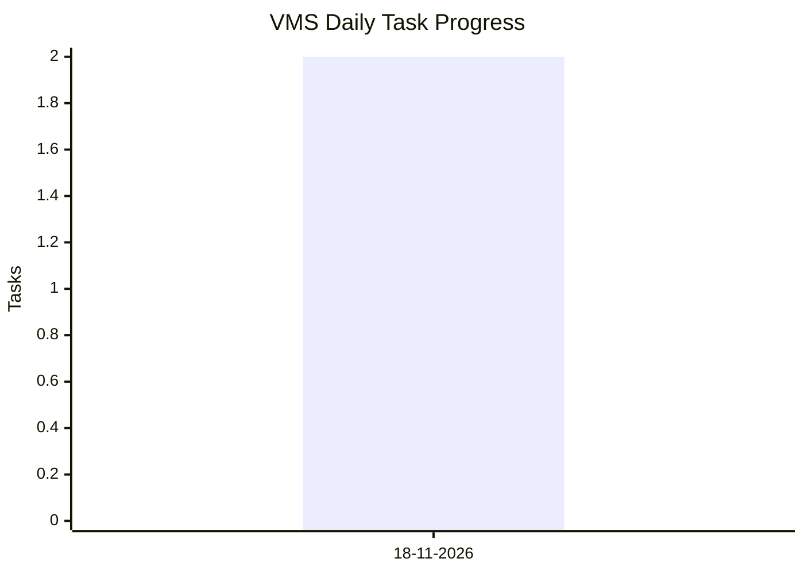
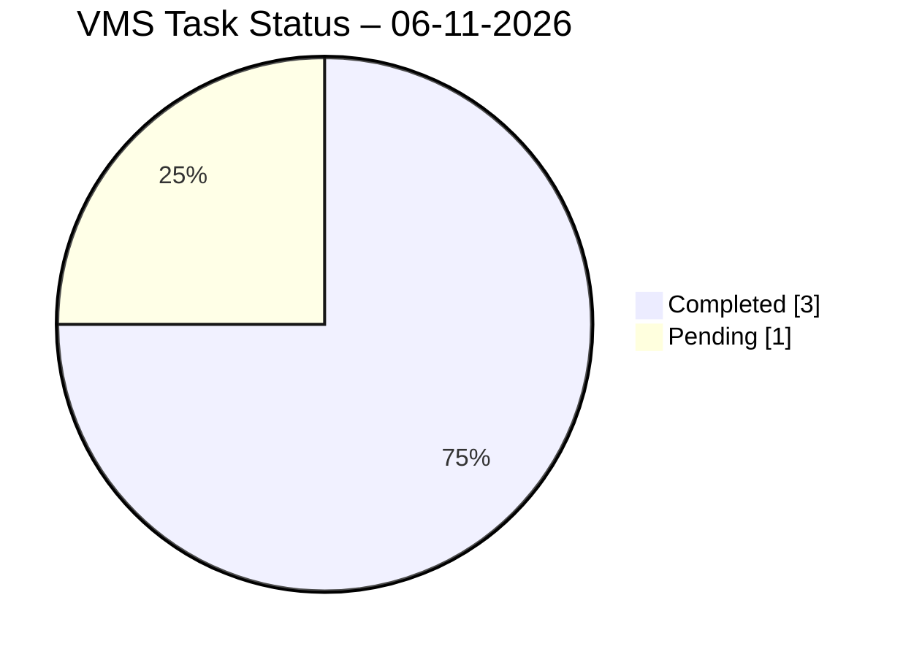
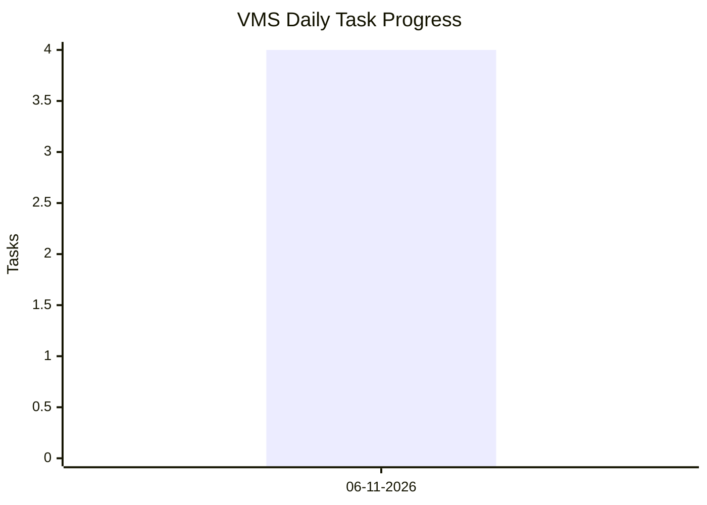

# 📊 Task & Progress Analytics: VMS

> Daily project analytics – 18 November 2026.

## 📈 Overall Metrics

- **Total Tasks:** `2`
- **Completed:** `2` (✅)
- **Pending:** `0` (⏳)
- **Resolution Rate:** `100%`

## 📊 Overall Task Distribution

## 📅 Daily Throughput

| Date | Completed | Pending | Total | Status |
|---|---:|---:|---:|---|
| 18-11-2026 | 2 | 0 | 2 | ✅ Completed |

## 📉 Daily Development Progress

*Bar: Total Created | Line: Completed*

## 📋 Task Details

| Task Description | Status |
|---|---|
| Dashboard – Tanker & Vehicle Fuel Filling Litres and Amount Mismatch Correction | ✅ Completed |
| Vehicle Fuel Date Correction, Incorrect Entry Deletion & Re-entry | ✅ Completed |
| Fuel Filling Report Verification | ✅ Completed |
| Maintenance Report Verification | ✅ Completed |

## 📌 Project Progress

- **Total Tasks:** 2
- **Completed Tasks:** 2
- **Pending Tasks:** 0
- **Overall Progress:** 100%

---

*Last Updated: 18 November 2026*  
*Project: Vehicle Management System (VMS)*

> Daily project analytics – 06 November 2026.

## 📈 Overall Metrics

- **Total Tasks:** `4`
- **Completed:** `3` (✅)
- **Pending:** `1` (⏳)
- **Resolution Rate:** `75%`

## 📊 Overall Task Distribution

## 📅 Daily Throughput

| Date | Completed | Pending | Total | Status |
|---|---:|---:|---:|---|
| 06-11-2026 | 3 | 1 | 4 | ⏳ 1 Pending |

## 📉 Daily Development Progress

*Bar: Total Created | Line: Completed*

## 📋 Task Details

| Task Description | Status |
|---|---|
| Vehicle Due List – From Date & To Date | ✅ Completed |
| Remove Scrapped Vehicles from Driver Mapping | ✅ Completed |
| Create Additional Admin ID for Assistant In-charge | ✅ Completed |
| Display Mapped Vehicle Registration Number in Driver List | ⏳ Pending |

## 📌 Project Progress

- **Total Requirements:** 4
- **Completed Requirements:** 3
- **Remaining Requirements:** 1
- **Overall Progress:** 75%

---

*Last Updated: 06 November 2026*  
*Project: Vehicle Management System (VMS)*
